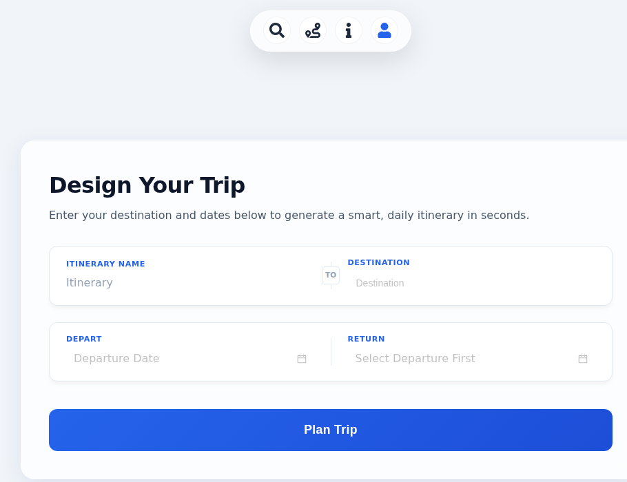
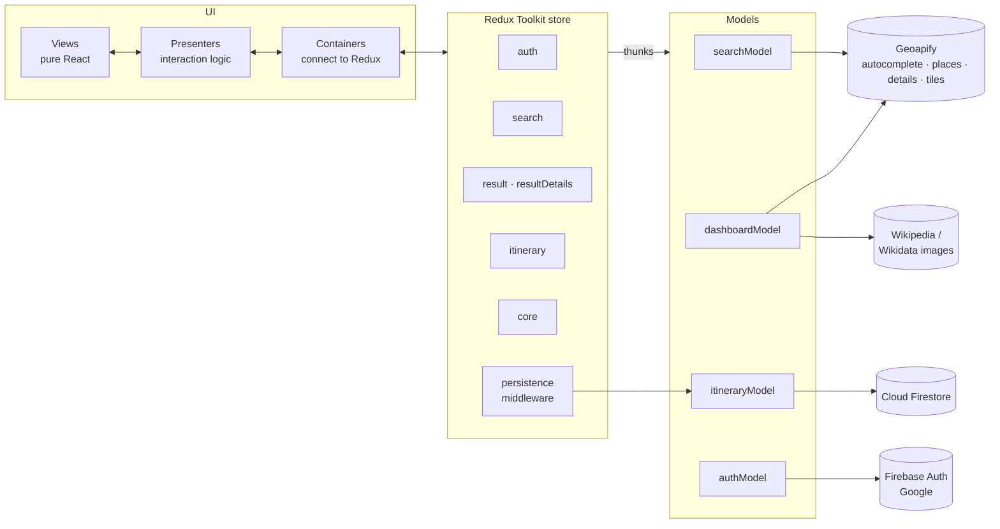
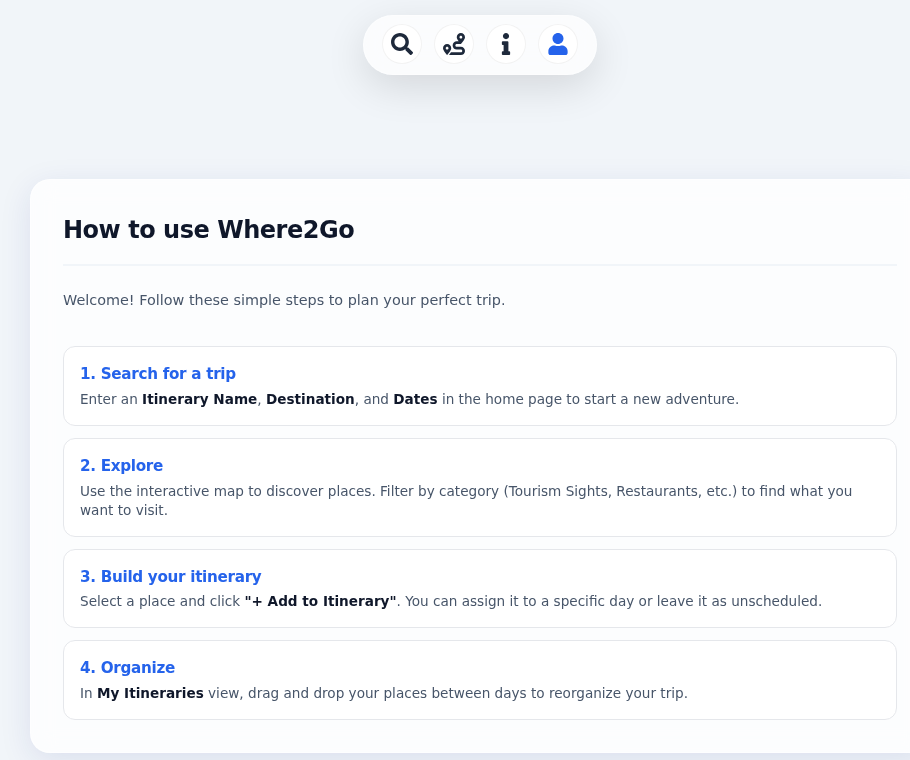

<div align="center">

# 🧭 Where2Go

**Pick a city and your dates. Explore what's worth visiting on an interactive map,
then drag it into a day-by-day itinerary.**


</div>


<p align="center">
  
  &nbsp;
  
</p>

---

## ✨ What it does

| | |
|---|---|
| 🔎 **Plan a trip** | Give the trip a name, pick a destination with live city autocomplete and choose a date range. |
| 🗺️ **Explore the map** | Up to 50 points of interest load on a Leaflet map, each with its own marker icon and colour by category. A synced sidebar lists them, and you can pan anywhere and hit **"Search this area"**. |
| 🏷️ **Filter by interest** | Show only the categories you care about: sights, museums, restaurants, bars, cafés, parks, nature, shopping, transport and more. |
| 🖼️ **Rich place cards** | Each place shows its address, contact details and website, plus a photo pulled from Wikipedia or Wikidata when one exists. |
| 📅 **Build an itinerary** | Add a place to a specific day or leave it unscheduled, then reorganise the trip by **dragging and dropping** places between days. |
| 👤 **Sign in or stay a guest** | Sign in with Google to keep your itineraries in the cloud, or try everything as a guest first. |
| 🔄 **Refresh-proof** | A session snapshot restores your search, map results and open itinerary after a page reload. |

---

## 🏗️ Architecture

The app follows a strict **Model → Presenter → View** split. Views are pure, props-only React components. Presenters hold the interaction logic, thin containers connect them to Redux, and models are the only layer that talks to external services.



### Design decisions worth a look

- **Persistence lives in a Redux middleware, not in components.** [`persistenceMiddleware.js`](src/app/middleware/persistenceMiddleware.js) listens for save and delete intents on itineraries and syncs the user's trip list to Firestore. When the write succeeds, it reloads the list into the store, so the UI never touches the database directly.
- **Guest mode and refresh survival.** [`sessionSnapshot.js`](src/app/sessionSnapshot.js) writes a small, versioned slice of state to `sessionStorage` and loads it back when the store starts. A guest who refreshes the page doesn't lose their trip.
- **Balanced results, not 50 restaurants.** Geoapify can return hundreds of places for one bounding box. [`dashboardModel.js`](src/app/models/dashboardModel.js) assigns each place a main category from a priority list and then **picks round-robin across categories**, so the map always shows a varied mix.
- **Images with graceful fallback.** A place card tries the Wikipedia summary image first, then the Wikidata `P18` (image) claim, and finally falls back to no image.
- **Static-hosting friendly.** Hash-based routing means the app deploys to Firebase Hosting, or any static host, with no rewrite rules.

---

## 🧪 Tested with real users

We ran a think-aloud session with a user who walked through the whole flow, from guest login to a finished itinerary.

These findings are listed as next steps below.

<p align="center">
  
</p>

---

## 🚀 Run it locally

**Requirements:** Node.js 20+, a free [Geoapify](https://www.geoapify.com/) API key and a Firebase project.

```bash
git clone https://github.com/<your-user>/where2go.git
cd where2go
npm install
cp .env.example .env      # fill in your keys
npm run dev               # → http://localhost:8080
```

**Firebase setup (≈5 min):**
1. Create a project and register a **Web app**, then copy its config values into `.env`.
2. Under **Authentication**, enable the **Google** provider and add your domain to the authorised domains.
3. Create a **Cloud Firestore** database. Itineraries are stored per user in the `Users` collection.

**Deploy:**
```bash
npm i -g firebase-tools && firebase login
firebase use --add        # pick your project
npm run deploy            # vite build + firebase deploy
```

> 🔐 This is a client-side app, so the Geoapify key ends up in the browser. **Restrict it to your domain** in the Geoapify dashboard. Firebase web config values are public by design, so protect your data with Firestore security rules.

---

## 📁 Project structure

```
src/
├── app/
│   ├── store.js                 # Redux store + session snapshot wiring
│   ├── features/                # Slices & thunks: auth, core, search, dashboard, itinerary
│   ├── middleware/
│   │   └── persistenceMiddleware.js   # Redux → Firestore sync
│   ├── models/                  # All external I/O: Geoapify, Wikipedia/Wikidata, Firebase
│   └── sessionSnapshot.js       # Refresh-proof session state
├── presenters/                  # Interaction logic + Redux containers, one folder per feature
├── views/                       # Pure UI components and their styles
└── components/                  # Reusable pieces: city autocomplete, date picker, 3D globe loader
```

---

<sub>Map data © OpenStreetMap contributors via Geoapify · Images from Wikimedia Commons</sub>
